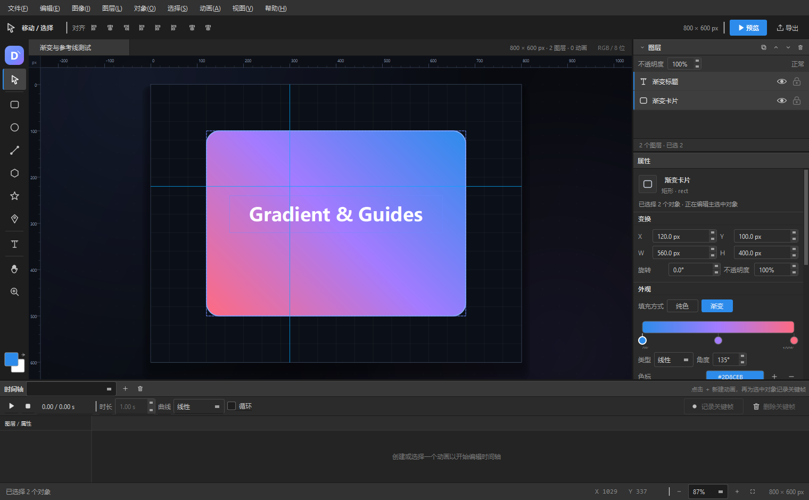
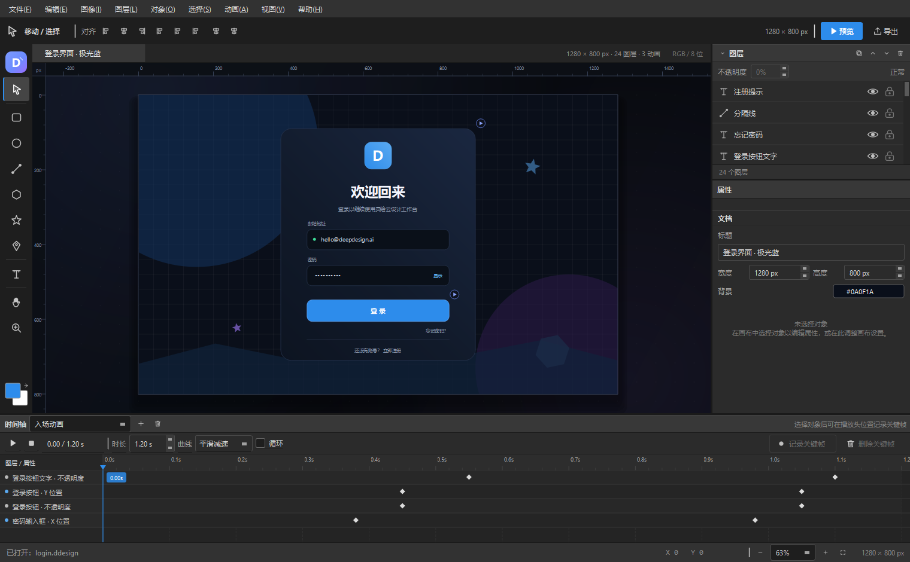
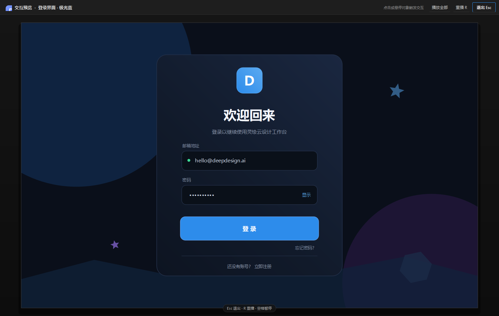
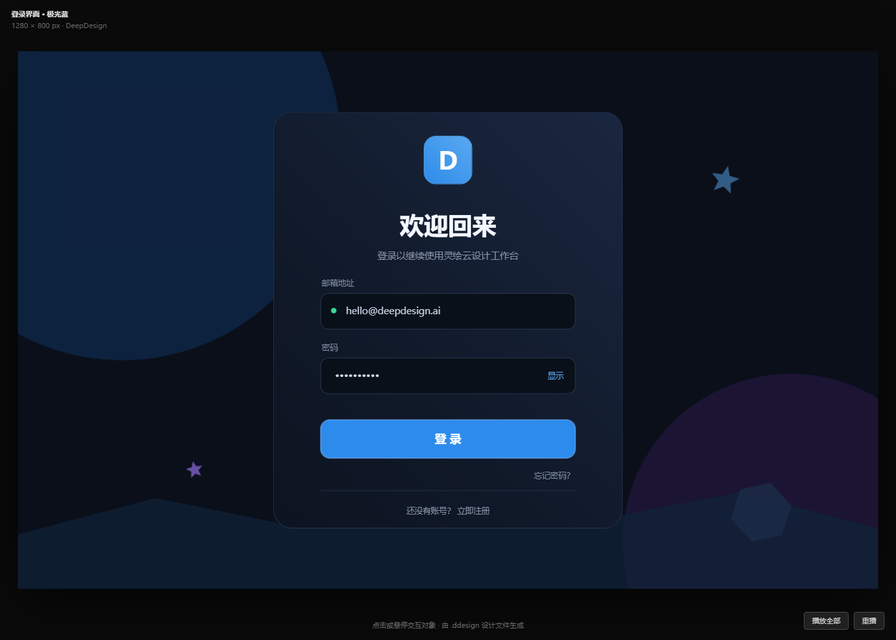
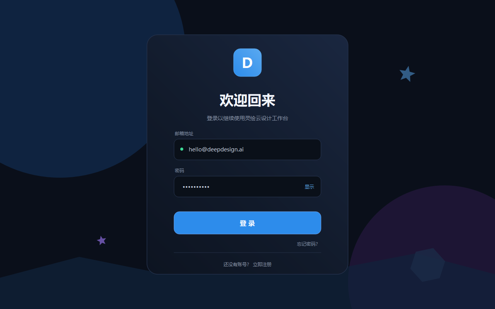
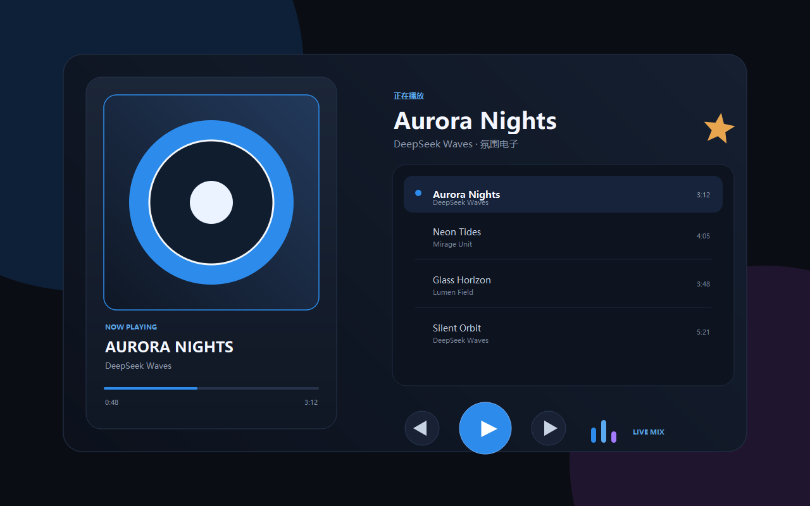

# 灵绘 DeepDesign Studio

> **一个用 Qt 6 / C++ 编写的 AI 原生 UI 交互设计软件。**  
> 在画布上画矩形、椭圆、直线、多边形、星形、自由路径和文字，调整渐变、参考线、图层，制作时间轴动效与点击/悬停交互；最后保存成 **DeepSeek 能直接读懂** 的 `.ddesign` 文件，或导出可交互 HTML + AI 交付包。




---

## 这个软件是做什么的？

DeepDesign Studio 是一个**面向 UI 交互设计的桌面设计工具**，工作方式类似 Photoshop / Figma 的裁剪版：

- 用形状和文字在画布上搭界面；
- 用图层、对齐、参考线做精确布局；
- 用纯色/渐变填充做视觉；
- 用时间轴做入场、悬停、点击反馈等动效；
- 用交互触发器把「点击 / 悬停 / 移出 / 载入」绑定到动画；
- 最后导出 **HTML 交互动效预览** 和 **AI 可读的设计数据**。

它和普通设计工具最大的区别是：**设计文件不是截图，而是结构化 JSON**。  
`.ddesign` 中包含每个元素的绝对坐标、尺寸、旋转、渐变、图层顺序、动画关键帧和交互关系，DeepSeek 等 AI 可以直接据此生成前端代码、Qt 界面或继续二次设计，而不需要“看图猜”。

### 适合谁？

- 想快速画 UI 原型、动效演示的设计师；
- 需要把设计稿交给 AI 生成代码的前端/全栈开发者；
- 想学习 Qt Widgets 自绘、画布、撤销栈、时间轴实现的 C++ 开发者；
- 需要一套“设计文件 → 规范 → 代码”完整链路的 AI 工程实践者。

### 能做什么 / 不能做什么

| 能做 | 暂不支持 |
|---|---|
| 形状、文字、自由路径绘制 | 自动布局 / 约束系统 |
| 选择、移动、缩放、旋转、多选、框选 | 布尔运算 / 蒙版 / 裁剪 |
| 图层排序、显隐、锁定、重命名 | 组 / 组件 / 实例 |
| 标尺、网格、智能吸附、参考线 | 富文本、字距/行距 |
| 纯色、线性/径向渐变、调色板 | 渐变停止点动画 |
| 时间轴关键帧、缓动、循环、预览 | 视频/音频轨道 |
| 点击/悬停/移出/载入交互 | 页面路由 / 多页面 |
| `.ddesign` 保存/读取、HTML + AI 包导出 | 响应式断点自动布局 |

---

## 界面速览

| 设计 + 渐变 + 参考线 | 时间轴 + 关键帧 |
|---|---|
|  |  |

| F5 交互预览 | 导出的 HTML 预览 |
|---|---|
|  |  |

| 登录界面示例 | 音乐播放器示例 |
|---|---|
|  |  |

---

## 快速开始

### 方式一：直接运行 Windows 版本（推荐给普通用户）

1. 打开仓库右侧 **Releases**，下载最新 `DeepDesignStudio-win64.zip`；
2. 解压后双击 `DeepDesignStudio.exe`（或 `run.bat`）；
3. 打开 `examples/login.ddesign` 体验完整示例。

> 需要 Windows 10/11 64 位。发布版已携带 Qt 运行库和插件，不需要安装 Qt。
> 如果要自己构建，见下方「从源码构建」。

### 方式二：从源码构建（Qt 6 / MinGW）

环境：

- Windows 10/11
- Qt 6.11.2 MinGW 64-bit（Qt 6.5+ 理论可用，未逐一验证）
- MinGW 13.1（随 Qt 安装）
- qmake（无需 CMake）

```bat
:: 1. 设置 Qt 路径（改成你自己的安装路径）
set QTDIR=D:\Qt6.11\6.11.2\mingw_64
set MINGW_BIN=D:\Qt6\Tools\mingw1310_64\bin

:: 2. 构建
build.bat

:: 3. 运行
run.bat
```

或手动：

```bat
mkdir build && cd build
"%QTDIR%\bin\qmake.exe" ..\DeepDesignStudio.pro -spec win32-g++
"%MINGW_BIN%\mingw32-make.exe" -j8
```

产物：`build\bin\DeepDesignStudio.exe`。

如果修改了 UI 或新增源文件，`build.bat` 会自动重新 qmake/make。

---

## 5 分钟上手

### 1. 画一个界面

1. 左侧工具栏选择 **矩形 R**。
2. 在画布拖拽绘制；单击则创建默认尺寸。
3. 右侧「属性」中修改 X/Y/W/H、圆角、填充、描边。
4. 用 **选择 V** 移动；拖动八个手柄缩放；拖动顶部圆形手柄旋转。
5. 按住 **Shift** 多选；在空白处拖拽框选。

### 2. 从标尺拉出参考线

- 从**上方标尺**按住左键向下拖 → 横向参考线（Y）。
- 从**左侧标尺**向右拖 → 纵向参考线（X）。
- 拖动参考线可继续调整；拖动时状态栏/浮层显示精确 px。
- 拖到画板外松开 → 删除。
- 靠近元素边缘/画板中心会自动吸附。
- `Ctrl+;` 显示/隐藏参考线。
- 视图 → 参考线，可新建/清除。

参考线会保存进 `.ddesign`，但**不会导出到 HTML**，只是设计辅助。

### 3. 加一个渐变

1. 选中形状 → 右侧「外观」→ 填充方式点 **渐变**。
2. 选择 **线性/径向**，设置角度。
3. 拖动渐变条下方的色标；双击色标改色；双击色条添加色标。
4. 用「添加/删除色标」按钮管理颜色数量。
5. 也可以直接点预设（极光/日落/薄荷/深空）或调色板颜色。
6. 调色板同时支持预设色和最近使用颜色。

> 渐变支持矩形、椭圆、多边形、星形、自由路径；文本颜色用「文字」区，直线用描边色。

### 4. 做一段动效

1. 选中对象 → 底部时间轴点 **＋** 新建动画。
2. 把播放头放在 0s，点 **记录关键帧**。
3. 拖动播放头到 0.8s，在属性面板修改位置/透明度/缩放等，再点 **记录关键帧**。
4. 设置时长、缓动（平滑减速、回弹、弹性等）、循环。
5. 按 **Ctrl+Space** 播放/暂停，拖动播放头预览。

关键帧可以拖动改时间，双击删除。时间轴轨道会按「元素 · 属性」分组显示。

### 5. 加一个交互

1. 选中对象（例如按钮）。
2. 右侧「交互」区：
   - 触发方式：点击 / 悬停 / 移出 / 载入；
   - 动作：播放动画 / 停止全部动画；
   - 选择动画 → 添加。
3. 按 **F5** 打开交互预览：
   - 点击/悬停对象触发；
   - 页面载入时自动执行 `load` 交互；
   - 按 R 重播，空格暂停，Esc 退出。

### 6. 保存和交付给 AI

- `Ctrl+S` 保存 `.ddesign`。
- `Ctrl+E` 导出 HTML / AI 交付包：

```text
index.html         可直接打开的 HTML 交互预览
design.json        完整设计数据（DeepSeek 唯一事实来源）
UI_SPEC.md         颜色/字体/图层/渐变/交互/动画规范
AI_HANDOFF.md      给 DeepSeek 的提示词、约束、校验清单
```

把整个目录或 `design.json + AI_HANDOFF.md` 发给 DeepSeek，即可让它按设计数据实现界面。

> 详细到每个按钮、每种工具的说明见 **[用户手册 docs/USER_GUIDE.md](docs/USER_GUIDE.md)**，常见问题见 **[FAQ](docs/FAQ.md)**。

---

## 功能清单

### 画布 / 绘图

- 矩形（圆角）、椭圆、直线、多边形（3–60 边）、星形、自由路径（钢笔）、文字
- 拖拽创建、单击默认尺寸、Shift 等比/45° 约束
- 选择、多选、框选、移动、八向缩放、自由旋转
- 网格、元素/画板智能吸附、尺寸与坐标浮层
- 滚轮缩放、空格/中键/抓手平移、Ctrl+0 适合屏幕、Ctrl+1 100%
- 复制/粘贴/剪切/复制图层/删除、撤销/重做
- 对齐（左右/居中/上下）、水平/垂直等距分布
- 图层上移/下移/置顶/置底、拖拽排序
- 画布尺寸、画布背景、PNG 导出

### 标尺 / 参考线

- 顶部/左侧标尺，实时显示画板坐标
- 从标尺拖出横/竖参考线
- 参考线拖动、吸附、拖出删除、Ctrl+; 显隐
- 参考线写入文件，用于手动测量和对齐

### 颜色 / 渐变

- 纯色/渐变填充切换
- 线性/径向渐变、多色标、角度、预设、调色板、最近颜色
- 完整 QColorDialog 取色
- 编辑器、F5 预览、PNG、HTML 中一致渲染

### 动效 / 交互

- 时间轴、关键帧、缓动、循环、播放/暂停/停止
- 动画属性：x/y/width/height/rotation/opacity/fill/strokeWidth
- 交互触发：click/hover/leave/load
- 动效动作：playAnimation/stopAll
- F5 模态交互预览
- 导出 HTML 使用 requestAnimationFrame 实时采样，支持多动画叠加

### 文件 / AI

- `.ddesign` 单文件 JSON
- JSON 往返、原子保存
- HTML + design.json + UI_SPEC + AI_HANDOFF 导出
- CLI：`--render`、`--export`、`--validate`、`--selftest`

---

## `.ddesign` 长什么样？

```json
{
  "format": "DeepDesign",
  "version": 1,
  "title": "登录界面",
  "canvas": { "width": 1280, "height": 800, "background": "#0A0F1A" },
  "elements": [
    {
      "id": "login_card",
      "type": "rect",
      "name": "登录卡片",
      "x": 380, "y": 90, "width": 520, "height": 620,
      "rotation": 0, "opacity": 1,
      "fill": "#121A2B",
      "gradient": {
        "type": "linear",
        "angle": 135,
        "stops": [
          { "position": 0, "color": "#1A2740" },
          { "position": 1, "color": "#0D1421" }
        ]
      },
      "stroke": "#23304A",
      "strokeWidth": 1.5,
      "radius": 28,
      "visible": true,
      "locked": false
    }
  ],
  "animations": [
    {
      "id": "anim_intro",
      "name": "入场动画",
      "duration": 1.2,
      "loop": false,
      "easing": "easeOutCubic",
      "tracks": [
        {
          "elementId": "login_card",
          "property": "opacity",
          "keyframes": [
            { "time": 0, "value": 0 },
            { "time": 0.55, "value": 1 }
          ]
        }
      ]
    }
  ],
  "interactions": [
    {
      "sourceId": "login_card",
      "trigger": "load",
      "action": "playAnimation",
      "animationId": "anim_intro"
    }
  ],
  "guides": [
    { "id": "guide_1", "orientation": "horizontal", "position": 220 }
  ]
}
```

完整规范：

- [设计文件格式](docs/DESIGN_FILE_FORMAT.md)
- [JSON Schema](docs/ddesign.schema.json)
- [AI 消费指南](docs/AI_UI_SPEC.md)
- [架构说明](docs/ARCHITECTURE.md)

---

## 给 DeepSeek 的用法

把导出的目录交给 DeepSeek，并说：

```text
请阅读 design.json 和 AI_HANDOFF.md，按设计数据实现一个 React/HTML 界面。
要求：
1. 绝对定位、像素级还原；
2. CSS/SVG 绘制图形，支持渐变；
3. requestAnimationFrame 实现时间轴动画，支持循环、缓动、多动画叠加；
4. 支持 click/hover/leave/load 交互；
5. 画板整体等比适配视口，不改变内部坐标。
```

`AI_HANDOFF.md` 已经包含：

- 设计概览；
- 直接可复制的完整提示词；
- 硬性约束；
- 元素/动画/渐变/交互映射表；
- 校验清单；
- design.json 摘要。

示例交付包：[export/login-package](export/login-package)

---

## 项目结构

```text
DeepDesignStudio/
├─ DeepDesignStudio.pro
├─ build.bat / run.bat / deploy.bat
├─ src/                    Qt/C++ 源码
│  ├─ main.cpp
│  ├─ Model.*              文档/元素/渐变/动画/交互/参考线
│  ├─ CanvasWidget.*       画布、工具、选择、缩放、旋转、参考线
│  ├─ Renderer.*           QPainter 渲染
│  ├─ PropertiesPanel.*    属性/渐变/调色板/交互
│  ├─ TimelinePanel.*      时间轴/关键帧
│  ├─ LayersPanel.*        图层
│  ├─ PreviewDialog.*      F5 预览
│  ├─ HtmlExporter.*       HTML + AI 包导出
│  ├─ SpecExporter.*       UI_SPEC / AI_HANDOFF
│  └─ ...
├─ docs/                   用户手册/格式规范/AI 指南/架构
├─ examples/               .ddesign 示例
├─ export/                 示例 HTML + AI 交付包
├─ screenshots/            截图
└─ tools/make_examples.py  示例生成脚本
```

---

## 构建与测试

### 构建

```bat
build.bat
```

### 生成可分发目录

```bat
deploy.bat
```

输出 `dist\DeepDesignStudio\`，包含 exe、Qt DLL、插件、docs、examples、screenshots。

### 自测

```bat
build\bin\DeepDesignStudio.exe --selftest
```

结果写入 `selftest-report.txt`。当前 **20 / 20 通过**，覆盖：

- 7 种元素类型
- 渐变 / 参考线 / 动画 / 交互
- JSON 往返
- 动画采样
- 离屏渲染
- HTML + CSS/SVG 渐变 + AI 文档导出

### CLI

```text
DeepDesignStudio --render <输入.ddesign> <输出.png> [缩放]
DeepDesignStudio --export <输入.ddesign> <输出目录>
DeepDesignStudio --validate <输入.ddesign>
DeepDesignStudio --selftest
```

---

## 快捷键

| 功能 | 快捷键 |
|---|---|
| 工具 | `V` 选择 · `R` 矩形 · `O` 椭圆 · `L` 直线 · `P` 多边形 · `S` 星形 · `N` 钢笔 · `T` 文字 · `H` 抓手 · `Z` 缩放 |
| 新建 / 打开 / 保存 / 另存为 | `Ctrl+N` / `Ctrl+O` / `Ctrl+S` / `Ctrl+Shift+S` |
| 导出 AI 包 / PNG | `Ctrl+E` / `Ctrl+Shift+E` |
| 撤销 / 重做 | `Ctrl+Z` / `Ctrl+Shift+Z`、`Ctrl+Y` |
| 拷贝 / 粘贴 / 剪切 / 复制图层 | `Ctrl+C` / `Ctrl+V` / `Ctrl+X` / `Ctrl+J` |
| 删除 / 全选 / 取消选择 | `Delete` / `Ctrl+A` / `Ctrl+D` |
| 图层顺序 | `Ctrl+]` / `Ctrl+[` / `Ctrl+Shift+]` / `Ctrl+Shift+[` |
| 缩放 | 滚轮；`Ctrl+0` 适合屏幕；`Ctrl+1` 100% |
| 参考线 / 标尺显隐 | `Ctrl+;` / `Ctrl+R` |
| 记录关键帧 / 播放暂停 / 停止 | `Ctrl+Alt+K` / `Ctrl+Space` / `Ctrl+Shift+Space` |
| 交互预览 | `F5` |
| 平移 | 空格+拖拽 / 中键拖拽 / 抓手工具 |

完整列表见 **[用户手册](docs/USER_GUIDE.md#快捷键)**。

---

## 示例

| 文件 | 内容 |
|---|---|
| [login.ddesign](examples/login.ddesign) | 深色极光登录界面：渐变卡片、入场动画、按钮悬停/点击反馈 |
| [music-player.ddesign](examples/music-player.ddesign) | Aurora 音乐播放器：渐变封面、播放脉冲、频谱循环 |
| [feature-test.ddesign](examples/feature-test.ddesign) | 渐变卡片 + 横竖参考线演示 |

导出示例：

- [登录界面 HTML 包](export/login-package)
- [音乐播放器 HTML 包](export/music-player-package)
- [渐变/参考线 HTML 包](export/feature-test-package)

---

## 常见问题

**Q：为什么直接双击 exe 提示缺少 Qt6Core.dll？**  
A：使用 `dist/DeepDesignStudio/` 中的部署版本，或运行 `deploy.bat`；源码产物 `build/bin` 需要 Qt DLL 在 PATH/同目录。

**Q：为什么构建时 qmake 报找不到编译器？**  
A：检查 `QTDIR` 和 `MINGW_BIN`，并确保两者是同一套 Qt/MinGW；`build.bat` 顶部可修改默认路径。

**Q：为什么渐变不能给文字用？**  
A：当前文本使用 `textColor` 单色；渐变用于形状填充。文字颜色可在「文字」或调色板中调整。

**Q：参考线会出现在导出的 HTML 里吗？**  
A：不会。参考线只用于编辑期测量/对齐。

**Q：动画数值是相对还是绝对？**  
A：绝对。`x=120` 表示元素 `left:120px`，不是偏移 120。

更多：[FAQ](docs/FAQ.md)

---

## Roadmap

- [ ] 渐变停止点动画
- [ ] 多文档标签页 / 自动保存
- [ ] 组 / 组件 / 实例
- [ ] 更多元素（图片、SVG 导入）
- [ ] 响应式布局与约束
- [ ] 导出 React / Vue / Flutter 工程
- [ ] 插件系统

---

## 贡献

欢迎提交 Issue / PR。请先阅读 [CONTRIBUTING.md](CONTRIBUTING.md)。  
如果这个项目对你有帮助，欢迎 Star ⭐。

维护者发布/上传指南：[docs/GITHUB_PUBLISH.md](docs/GITHUB_PUBLISH.md)。

## License

本项目源代码采用 **MIT License**，详见 [LICENSE](LICENSE)。  
Qt 6 按其 **LGPLv3**（或商业许可）使用；发布二进制时请遵守 Qt 的许可要求，详见 [THIRD_PARTY_NOTICES.md](THIRD_PARTY_NOTICES.md)。
