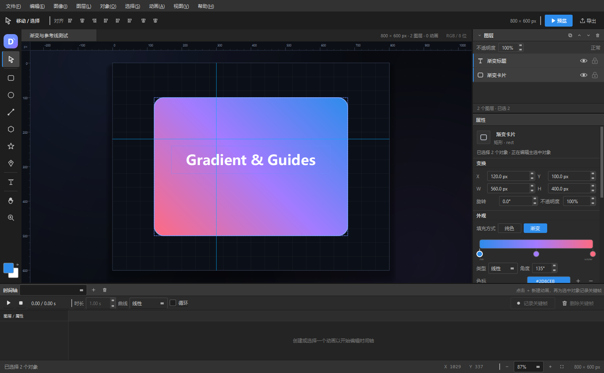
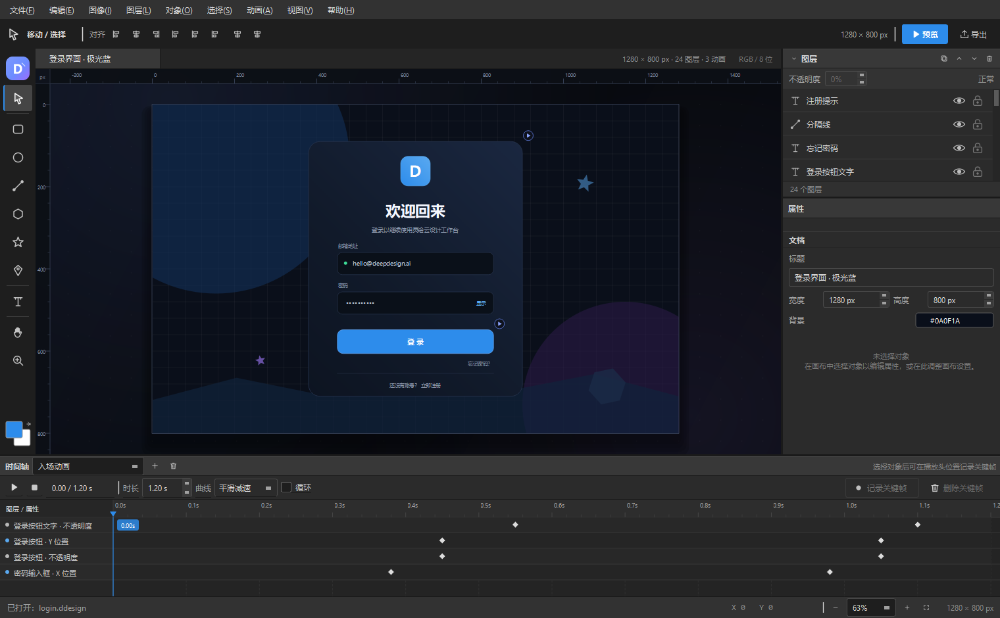
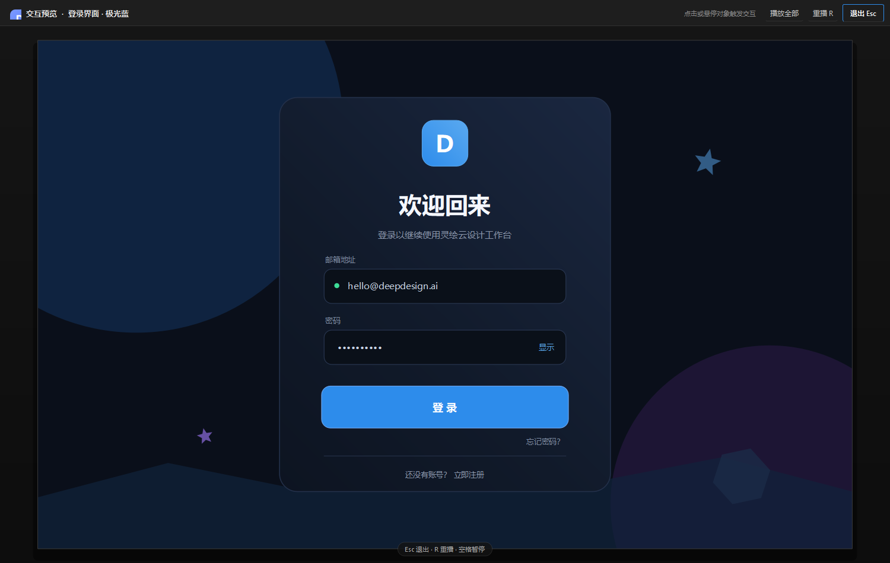

# 灵绘 DeepDesign Studio · 用户手册

版本：1.0  
适用：Windows 10/11 64 位  
界面语言：简体中文

> 本文是完整使用说明。想先跑起来，请先看 [README](../README.md) 的「快速开始」。

---

## 目录

1. [软件定位](#1-软件定位)
2. [启动与界面](#2-启动与界面)
3. [文件操作](#3-文件操作)
4. [画布基础](#4-画布基础)
5. [绘图工具](#5-绘图工具)
6. [选择与变换](#6-选择与变换)
7. [网格、吸附、标尺与参考线](#7-网格吸附标尺与参考线)
8. [图层](#8-图层)
9. [属性面板](#9-属性面板)
10. [颜色与渐变系统](#10-颜色与渐变系统)
11. [时间轴与动画](#11-时间轴与动画)
12. [交互](#12-交互)
13. [交互预览](#13-交互预览)
14. [保存与导出](#14-保存与导出)
15. [完整工作流示例](#15-完整工作流示例)
16. [快捷键](#16-快捷键)
17. [CLI 与自测](#17-cli-与自测)
18. [常见问题](#18-常见问题)
19. [限制与建议](#19-限制与建议)

---

## 1. 软件定位

灵绘 DeepDesign Studio 是一个轻量的 UI 交互设计工具：

- 用形状和文字搭界面；
- 用图层、参考线和吸附做布局；
- 用渐变和调色板做视觉；
- 用时间轴做动效；
- 用交互触发器把点击/悬停和动画连接；
- 保存为 `.ddesign` JSON；
- 导出可交互 HTML 和给 AI 的交付包。

它不追求替代完整的 Figma/Photoshop，而是提供一条**从设计到 AI 代码生成**的最小完整链路。

---

## 2. 启动与界面

### 2.1 启动

发布版：

```text
dist\DeepDesignStudio\DeepDesignStudio.exe
```

或双击 `dist\DeepDesignStudio\run.bat`。

源码版：

```bat
build.bat
run.bat
```

### 2.2 界面结构



从上到下、从左到右：

| 区域 | 说明 |
|---|---|
| 菜单栏 | 文件 / 编辑 / 图像 / 图层 / 对象 / 选择 / 动画 / 视图 / 帮助 |
| 工具选项栏 | 当前工具的上下文选项（形状填充、描边、文字、缩放、对齐等） |
| 左侧工具栏 | 选择、矩形、椭圆、直线、多边形、星形、钢笔、文字、抓手、缩放；底部为默认填充色 |
| 文档标签栏 | 当前文件名、图层/动画数量、RGB 标识 |
| 画布 | 顶部/左侧标尺、网格、画板、参考线、选择手柄 |
| 右侧图层面板 | 图层列表、不透明度、复制/排序/删除 |
| 右侧属性面板 | 变换、外观、渐变、调色板、文字、交互；未选择对象时显示文档属性 |
| 底部时间轴 | 动画选择、新建/删除动画、播放、时长、曲线、循环、记录关键帧 |
| 状态栏 | 提示、光标坐标、缩放、画布尺寸 |

右侧面板内容较多时可以**向下滚动**。

### 2.3 窗口与面板

- 拖动分隔条可调整画布 / 时间轴、图层 / 属性的比例。
- 视图菜单可显示/隐藏时间轴、右侧面板。
- 关闭窗口时如果有未保存修改，会询问保存/不保存/取消。

---

## 3. 文件操作

### 3.1 新建

`文件 → 新建`（`Ctrl+N`）创建 1280 × 800 空白画板。

### 3.2 打开

`文件 → 打开`（`Ctrl+O`）选择 `.ddesign` 或 `.json`。  
也支持把文件**拖拽到窗口**打开。

### 3.3 保存

- `Ctrl+S`：保存到当前文件；未保存过则弹出另存为。
- `Ctrl+Shift+S`：另存为。
- 保存使用原子写入，避免中途失败损坏原文件。

### 3.4 最近修改状态

文档标签前出现 `●` 表示有未保存修改；撤销回初始状态后 `●` 会消失。

### 3.5 导出

- `Ctrl+E`：导出 HTML / AI 交付包。
- `Ctrl+Shift+E`：导出 PNG 预览图（2× 分辨率）。
- 菜单 `文件 → 打开示例` 可打开内置示例。

---

## 4. 画布基础

### 4.1 缩放

| 操作 | 结果 |
|---|---|
| 鼠标滚轮 | 以光标位置为中心缩放 |
| 抓手工具 + 拖动 | 平移 |
| 空格 + 左键拖动 | 临时平移 |
| 中键拖动 | 平移 |
| `Ctrl+0` | 适合屏幕 |
| `Ctrl+1` | 100% |
| 状态栏 `− / + / 适合` | 缩放 |
| 状态栏百分比下拉 | 选择/输入缩放 |

缩放范围约 5%–800%。

### 4.2 坐标

- 画板左上角 `(0,0)`。
- 状态栏实时显示光标位置 `X / Y`。
- 顶部/左侧标尺显示画板坐标，随缩放自动调整刻度。

### 4.3 画板

`图像 → 画布大小…` 修改宽高；`图像 → 画布背景颜色…` 修改背景色。  
修改画布尺寸不会移动已有元素。

---

## 5. 绘图工具

所有工具都可以用左侧按钮选择，快捷键见[第 16 节](#16-快捷键)。

### 5.1 矩形 `R`

- 拖拽绘制任意矩形；按住 `Shift` 拖拽为正方形。
- 单击画布创建默认尺寸。
- 属性面板可调圆角 `radius`、填充、描边、粗细。
- 支持纯色/渐变。

### 5.2 椭圆 `O`

- 拖拽绘制任意椭圆；`Shift` 为正圆。
- 单击创建默认尺寸。
- 支持纯色/渐变。

### 5.3 直线 `L`

- 拖拽绘制，`Shift` 锁定 45° 角度。
- 颜色来自**描边**（无描边时回退填充色），最小显示宽度 1px。
- 属性面板无填充/渐变（直线没有填充语义）。

### 5.4 多边形 `P`

- 拖拽绘制；`Shift` 等比。
- 属性面板「边数」可设 3–60 边（默认 6）。
- 支持纯色/渐变。

### 5.5 星形 `S`

- 拖拽绘制；`Shift` 等比。
- 默认 5 角；边数决定角数，内外半径比 1:0.44。
- 支持纯色/渐变。

### 5.6 钢笔 / 自由路径 `N`

1. 在画布上逐点单击添加锚点。
2. 双击最后一点或按 `Enter` 完成。
3. 鼠标靠近起点时会出现绿色圆环，点击可闭合。
4. 按 `Esc` 取消。
5. 完成后可在属性面板勾选/取消「闭合路径」。

路径点以归一化坐标保存，缩放元素时形状一起缩放。

### 5.7 文字 `T`

1. 选择文字工具，在画布单击创建文本框。
2. 自动进入内联编辑，输入内容。
3. `Ctrl+Enter` 确认，`Esc` 取消，点击空白处也会确认。
4. 双击已有文字可再次编辑。
5. 属性面板「文字」区可设置字体、字号、粗体、对齐、颜色；支持多行和自动换行。

### 5.8 抓手 `H`

拖拽平移画布。

### 5.9 缩放 `Z`

- 左键单击放大。
- `Alt` + 单击缩小。

### 5.10 绘制后的行为

绘制完成会自动切回**选择工具**，方便继续调整。

---

## 6. 选择与变换

### 6.1 选择

- 单击对象选中。
- `Shift` + 单击追加/取消。
- 在空白处拖拽框选。
- `Ctrl+A` 全选；`Ctrl+D` 取消选择。
- 锁定对象不能在画布中直接点选（可在图层中选中）。

### 6.2 移动

- 拖拽选中对象。
- 方向键移动 1px；`Shift+方向键` 移动 10px。
- 多选时整体移动。
- 靠近画板/其他元素边缘、中心时显示吸附参考线。

### 6.3 缩放

选中单个对象时出现 8 个手柄：

- 四角：自由缩放；`Shift` 保持比例。
- 四边：单方向缩放。
- 带旋转的对象也能正确缩放（围绕对角锚点）。

### 6.4 旋转

- 拖动顶部圆形手柄旋转。
- `Shift` 吸附 15°。
- 旋转围绕元素中心。

### 6.5 对齐与分布

- `对象 → 对齐`：左 / 水平居中 / 右 / 顶 / 垂直居中 / 底。
- 单选时对齐到画板；多选时对齐到选区包围盒。
- `对象 → 分布`：水平/垂直等距（至少 3 个对象）。

### 6.6 图层顺序

- `Ctrl+]` 上移一层，`Ctrl+[` 下移一层。
- `Ctrl+Shift+]` 置顶，`Ctrl+Shift+[` 置底。
- 也可以在图层列表中拖拽排序。

### 6.7 复制/删除

- `Ctrl+C/V/X` 拷贝/粘贴/剪切。
- `Ctrl+J` 复制图层（偏移 18px）。
- `Delete` 删除选中。

---

## 7. 网格、吸附、标尺与参考线

### 7.1 网格

`视图 → 显示网格`（`Ctrl+'`）。网格只用于编辑辅助，不参与导出。

### 7.2 吸附

`视图 → 吸附与智能参考线`（`Ctrl+Shift+'`）。  
移动对象时吸附到：

- 画板边缘和中心；
- 其他元素的左/中/右、上/中/下；
- 网格（10px）。

### 7.3 标尺

`视图 → 显示标尺`（`Ctrl+R`）。  
标尺随缩放显示画板坐标，光标移动时标尺上显示位置指示。

### 7.4 参考线（重点）

参考线用于**手动测量和手动视觉对齐**。

**创建：**

- 从**上方标尺**按住左键向下拖 → 横向参考线（Y = position）。
- 从**左侧标尺**按住左键向右拖 → 纵向参考线（X = position）。

**调整：**

- 用选择工具靠近参考线，光标变化后拖动。
- 拖动时浮层显示 `Y 220 px` / `X 300 px`。
- 吸附开启时，靠近元素边缘/中心/画板中心会自动对齐。

**删除：**

- 把参考线拖出画板边界松开。
- 或 `视图 → 参考线 → 清除全部参考线`。

**显隐/新建：**

- `Ctrl+;` 显示/隐藏。
- `视图 → 参考线` 可新建横向/纵向参考线（输入坐标）或清除全部。

参考线保存到 `.ddesign` 的 `guides` 数组；导出 HTML 时**不会渲染**参考线。

---

## 8. 图层



### 8.1 图层列表

- 从上到下 = 从**顶层到底层**。
- 单击选中；`Shift` 多选。
- 右侧眼睛图标：显示/隐藏。
- 右侧锁图标：锁定/解锁。
- 双击图层名称：重命名。
- 拖拽图层：调整顺序。

### 8.2 图层操作按钮

图层面板右上角：

- 复制图层；
- 上移一层；
- 下移一层；
- 删除图层。

### 8.3 不透明度

图层面板顶部「不透明度」对当前所有选中对象生效。  
属性面板中的「不透明度」只修改主选中对象。

### 8.4 锁定/隐藏规则

- 隐藏：不显示、不可点选、不参与导出。
- 锁定：画布中不可点选/移动，但仍可在图层列表选中并编辑属性。

---

## 9. 属性面板

未选择对象时显示**文档属性**：

- 文档标题
- 画布宽度/高度
- 画布背景色

选中对象后显示：

### 9.1 对象信息

- 类型图标和类型名
- 图层名称（可编辑）
- 对象 ID
- 多选时提示「正在编辑主选中对象」

### 9.2 变换

| 字段 | 说明 |
|---|---|
| X / Y | 未旋转矩形的左上角坐标 |
| W / H | 宽高 |
| 旋转 | 角度，围绕中心 |
| 不透明度 | 0–100% |

### 9.3 外观

- 填充方式：纯色 / 渐变
- 填充色或渐变编辑器
- 描边颜色、粗细
- 圆角（矩形）
- 边数（多边形/星形）
- 闭合路径（路径）
- 调色板

### 9.4 文字

仅文本对象显示：

- 文本内容（多行）
- 字体、字号
- 粗体
- 文字颜色
- 水平对齐

### 9.5 交互

见[第 12 节](#12-交互)。

---

## 10. 颜色与渐变系统


### 10.1 纯色

1. 选中形状。
2. 外观 → 填充方式 → **纯色**。
3. 点击填充色块打开取色器（HSV/RGB/十六进制/吸管）。
4. 或点击下方预设/最近颜色。

### 10.2 渐变

1. 填充方式 → **渐变**。
2. 类型：线性 / 径向。
3. 角度：0° 从左到右，90° 从上到下；径向忽略角度。
4. 渐变条下方是色标：
   - 拖动色标 → 改变位置；
   - 双击色标 → 改颜色；
   - 双击渐变条空白处 → 添加色标；
   - 选中色标后用「添加/删除色标」按钮。
5. 预设：极光 / 日落 / 薄荷 / 深空。
6. 调色板可把颜色应用到**当前选中的色标**。

### 10.3 调色板

- 20 个预设颜色；
- 自动记录最近使用的颜色；
- 点击颜色应用：
  - 纯色填充 → 填充色；
  - 渐变 → 当前色标；
  - 文本 → 文字颜色；
  - 直线 → 描边色。

### 10.4 适用范围

- 渐变用于矩形、椭圆、多边形、星形、自由路径的**填充**。
- 文本使用 `textColor` 单色；直线使用描边色。
- 渐变元素上的 `fill` 动画会被忽略（当前限制）。

### 10.5 导出映射

- CSS：`linear-gradient(angle+90deg, stops...)` / `radial-gradient(circle at 50% 50%, ...)`。
- SVG：`<linearGradient>` / `<radialGradient>` + `fill="url(#id)"`。
- 颜色支持 `#RRGGBB` 与 `#RRGGBBAA`。

---

## 11. 时间轴与动画

### 11.1 新建动画

1. 选中对象。
2. 时间轴顶部点 **＋**。
3. 默认创建「动画 1」，如果是首次会自动尝试记录初始关键帧。
4. 可直接编辑动画名称（下拉框可输入）。

### 11.2 记录关键帧

- 把播放头拖到目标时间（如 0s / 0.6s / 1.2s）。
- 点击 **记录关键帧**。
- 一次会记录：
  - x、y、width、height、rotation、opacity；
  - 非文本对象还会记录 `fill` 颜色。
- 在同一时间重复记录会覆盖当前值。

推荐流程：

1. 0s 记录初始状态；
2. 拖到 0.8s，修改位置/透明度；
3. 再记录；
4. 播放查看。

### 11.3 关键帧编辑

- 时间轴轨道按「元素 · 属性」显示。
- 关键帧是菱形：
  - 拖动 → 改变时间；
  - 单击 → 选中，可点「删除关键帧」；
  - 双击 → 删除。
- 拖动播放头可预览任意时间点。

### 11.4 动画设置

- **时长**：0.1–120s。
- **曲线**：线性、缓入、缓出、缓入缓出、平滑减速、回弹、弹性、弹跳。
- **循环**：循环播放。
- **播放/暂停**：`Ctrl+Space`。
- **停止**：回到 0s。

### 11.5 动画属性

支持：

`x`、`y`、`width`、`height`、`rotation`、`opacity`、`fill`、`strokeWidth`

数值是**绝对值**，不是偏移量。

### 11.6 多个动画

可以创建多个动画并在交互中分别播放。多个动画同时作用于同一属性时，后触发的覆盖先触发的。

---

## 12. 交互

### 12.1 添加交互

1. 选中触发对象（按钮、卡片等）。
2. 右侧「交互」区。
3. 选择触发方式：
   - 点击（click）
   - 悬停（hover）
   - 移出（leave）
   - 载入时（load）
4. 选择动作：
   - 播放动画
   - 停止全部动画
5. 选择目标动画。
6. 点击「添加」。
7. 在列表中选择交互可删除。

### 12.2 语义

- 同一对象可以添加多个交互。
- 同一动画重复触发会从头播放。
- `load` 交互在 F5 预览/HTML 打开时自动执行。
- 交互对象在画布上会显示小的播放角标（编辑器辅助）。

### 12.3 键盘可访问性（导出 HTML 时）

- 有 click/hover 交互的对象会设置 `cursor:pointer` 和 `tabindex`。
- Enter / Space 可触发 click 交互。

---

## 13. 交互预览

按 **F5** 或顶部「预览」。



- 预览窗口按比例适配屏幕；
- `load` 交互自动播放；
- 点击/悬停/移出对象触发对应交互；
- `R` 重播；
- 空格暂停/继续；
- `Esc` 退出；
- 顶部按钮：播放全部 / 重播 / 退出。

预览使用独立文档副本，不会修改设计文件。

---

## 14. 保存与导出

### 14.1 `.ddesign`

单文件 JSON，包含：

- 画板
- 元素（含渐变）
- 动画
- 交互
- 参考线

### 14.2 HTML / AI 交付包

`Ctrl+E` 选择目录后生成：

```text
index.html         自包含 HTML 交互动效预览
design.json        完整设计数据
UI_SPEC.md         颜色/字体/图层/渐变/交互/动画规范
AI_HANDOFF.md      给 DeepSeek 的提示词、约束、校验清单
```

`index.html` 特点：

- 纯 HTML/CSS/内联 SVG，无外部图片依赖；
- requestAnimationFrame 动画引擎；
- 支持渐变、多动画叠加、循环、stopAll；
- 支持 click/hover/leave/load；
- 画板整体等比缩放。

调试/截图时可以用 `index.html?noanim=1` 跳过 load 动画，直接看最终静态画面。

### 14.3 PNG

`Ctrl+Shift+E`，导出 2× 分辨率画板 PNG。

### 14.4 给 DeepSeek

把导出目录整个拖给 DeepSeek，或发送：

- `design.json`
- `AI_HANDOFF.md`
- `UI_SPEC.md`

提示词可直接复制 `AI_HANDOFF.md` 中的「直接使用的提示词」。

---

## 15. 完整工作流示例

### 15.1 做一个登录界面（参考 login.ddesign）

1. 新建 1280×800。
2. 画两个大椭圆做背景光晕（可放画板外，超出部分被画板裁剪）。
3. 画一个 520×620 的圆角矩形卡片，设置渐变：深蓝 → 更深蓝。
4. 加 72×72 圆角矩形 logo，加渐变、加文字 D。
5. 加标题/副标题文字。
6. 加两个输入框矩形 + 文字；按钮矩形 + 文字。
7. 加分隔线、底部提示。
8. 时间轴做入场动画：卡片 opacity 0→1，标题 y 偏移，按钮 y 偏移。
9. 按钮加 hover 动画（颜色/尺寸变化）和 click 动画（颜色反馈）。
10. 卡片加 load → 入场动画。
11. F5 预览；Ctrl+S 保存；Ctrl+E 导出 AI 包。

### 15.2 做一个音乐播放器（参考 music-player.ddesign）

1. 画主卡片、专辑卡片、封面。
2. 用椭圆叠出唱片/环，加星形收藏图标。
3. 进度条用两个矩形（背景 + 进度）。
4. 播放按钮用椭圆 + 三角形（多边形，3 边，旋转 90°）。
5. 时间轴做入场动画和循环的播放脉冲/频谱律动。
6. 播放按钮加 click → 脉冲 + 频谱动画。
7. 封面加 hover → 放大/旋转效果。

### 15.3 渐变 + 参考线（参考 feature-test.ddesign）

1. 新建 800×600。
2. 画 560×400 矩形，渐变 3 色标（蓝 → 紫 → 粉）。
3. 从上方标尺拖出横向参考线到 Y=220。
4. 从左侧标尺拖出纵向参考线到 X=300。
5. 用参考线对齐文字/卡片。
6. 保存；导出 HTML 检查渐变。

---

## 16. 快捷键

| 分类 | 快捷键 |
|---|---|
| 工具 | `V` 选择 · `R` 矩形 · `O` 椭圆 · `L` 直线 · `P` 多边形 · `S` 星形 · `N` 钢笔 · `T` 文字 · `H` 抓手 · `Z` 缩放 |
| 画布 | 滚轮缩放 · 空格/中键拖拽平移 · `Ctrl+0` 适合屏幕 · `Ctrl+1` 100% |
| 文件 | `Ctrl+N` 新建 · `Ctrl+O` 打开 · `Ctrl+S` 保存 · `Ctrl+Shift+S` 另存为 · `Ctrl+E` 导出 AI 包 · `Ctrl+Shift+E` 导出 PNG |
| 编辑 | `Ctrl+Z` 撤销 · `Ctrl+Shift+Z` / `Ctrl+Y` 重做 · `Ctrl+C/V/X` 拷贝/粘贴/剪切 · `Ctrl+J` 复制图层 · `Delete` 删除 |
| 选择 | `Ctrl+A` 全选 · `Ctrl+D` 取消选择 |
| 图层 | `Ctrl+]` 上移 · `Ctrl+[` 下移 · `Ctrl+Shift+]` 置顶 · `Ctrl+Shift+[` 置底 |
| 辅助 | `Ctrl+;` 参考线显隐 · `Ctrl+R` 标尺显隐 · `Ctrl+'` 网格显隐 · `Ctrl+Shift+'` 吸附开关 |
| 动画 | `Ctrl+Alt+K` 记录关键帧 · `Ctrl+Space` 播放/暂停 · `Ctrl+Shift+Space` 停止 |
| 预览 | `F5` 打开 · `R` 重播 · 空格暂停 · `Esc` 退出 |
| 微调 | 方向键 1px · `Shift+方向键` 10px |

> 部分快捷键只在画布获得焦点时生效，避免与文本输入冲突。

---

## 17. CLI 与自测

```text
DeepDesignStudio --selftest
DeepDesignStudio --render <输入.ddesign> <输出.png> [缩放]
DeepDesignStudio --export <输入.ddesign> <输出目录>
DeepDesignStudio --validate <输入.ddesign>
```

- `--selftest`：运行 20 项内置测试，结果写入 `selftest-report.txt`。
- `--render`：画板离屏渲染为 PNG。
- `--export`：生成 HTML + AI 交付包。
- `--validate`：输出标题、画板、元素、动画、交互、参考线数量。

示例：

```bat
build\bin\DeepDesignStudio.exe --render examples\login.ddesign screenshots\login.png 2
build\bin\DeepDesignStudio.exe --export examples\music-player.ddesign export\music
```

---

## 18. 常见问题

### 启动时报缺少 DLL

使用 `dist/DeepDesignStudio/` 部署目录，或把 Qt 的 `bin` 加入 PATH。

### 构建时 qmake 找不到编译器

检查：

- `QTDIR` 指向 Qt 的 `mingw_64`；
- `MINGW_BIN` 指向对应 MinGW 的 `bin`；
- 两者版本匹配；
- 路径不要用错位的反斜杠/引号。

### 中文路径导致 moc 警告

Qt/qmake 在中文路径下可能打印 moc 预编译头警告，但不影响构建；本项目的 `E:\ai软件\...` 已实际构建通过。

### 渐变不显示

- 确认已切换填充方式为「渐变」；
- 确认至少 2 个色标；
- 文字/直线不支持渐变填充。

### 参考线拖不出来

- 必须从标尺区域开始拖：上方标尺 → 横线，左侧标尺 → 竖线；
- 画布滚轮缩放后依然可用；
- 如果标尺隐藏，`Ctrl+R` 打开。

### 动画不播放

- 时间轴至少要有一个动画和关键帧；
- 选中对象后点「记录关键帧」；
- 交互动作要选择正确的动画；
- F5 预览中 `load` 交互会自动执行，但 click 需要点击对象。

### HTML 和编辑器不完全一样

- 字体渲染由浏览器决定，可能存在 1–2px 差异；
- 文本换行/垂直居中在浏览器和 Qt 中略有差别；
- 渐变角度已按 CSS 换算，方向一致。

更多：[FAQ](FAQ.md)

---

## 19. 限制与建议

### 当前限制

- 固定画板 + 绝对定位，无自动布局/约束。
- 无组/组件/实例。
- 文本不支持富文本、字距/行距。
- 渐变停止点动画暂未开放。
- 参考线不参与最终渲染。
- 多文档标签页/自动保存未实现。
- 无图片导入。

### 使用建议

- 画板尺寸按目标设备设定（如 1280×800、390×844）。
- 图层命名使用业务语义（按钮/标题/输入框），方便 AI 推断。
- 先做主布局，再加渐变，再做动画。
- 动画属性是绝对值，先记录 0s，再改时间点。
- 交付前用 F5 和导出 HTML 各检查一次。
- 需要给 AI 时优先提供整个导出包，而不是只发截图。

---

## 附录：相关文档

- [README](../README.md)
- [设计文件格式](DESIGN_FILE_FORMAT.md)
- [JSON Schema](ddesign.schema.json)
- [AI 消费/实现指南](AI_UI_SPEC.md)
- [架构说明](ARCHITECTURE.md)
- [FAQ](FAQ.md)
